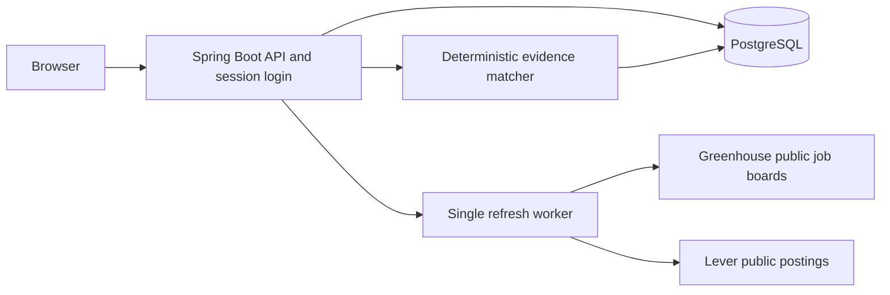

# Architecture and tradeoffs

JobTrail is a single-user workspace. A React client talks to a Spring Boot API; PostgreSQL stores all durable state. The production container serves both the compiled client and API on one port, avoiding separate hosting and cross-origin authentication.

## Collection and persistence

An employer board has a provider and validated board key. Adapters construct requests to fixed public API hosts; users cannot make the server fetch arbitrary URLs. They reject incomplete pagination and malformed snapshots. HTML descriptions become plain text and outbound job links require HTTPS.

A refresh records durable progress and processes enabled boards one at a time. Each successful board snapshot commits in its own transaction. Jobs are unique by source and provider posting ID. Refreshing updates descriptions and timestamps, preserves application status, and marks missing postings inactive only after a complete successful snapshot. Failed boards retain their prior listings. A job that reappears keeps its original identity and history.

The worker is deliberately single-instance. Run one application replica. On restart, interrupted runs become failed; refresh again to resume collection. Scheduled refresh is optional and cannot execute while a free web host is asleep. Manual refresh has a 30-second minimum interval.

## Search and ranking

Search applies whitespace-separated terms with AND semantics across title, company, location and description. Literal wildcard characters are escaped. Filtering, ranking, and pagination happen in the database. The default engineering-title filter can be disabled for a broader search.

Priority is an explainable heuristic: engineering title +100, junior +35, mid-level +30, unspecified level +10, explicit remote +20, the DC region +20, and explicit US location wording +10. Title-based seniority and location-based work mode are imperfect; unknown values remain unknown. The UI labels first-seen dates separately from employer publication dates. Lever does not provide a verified publication date through the documented public contract used here.

## Profile and matching

No personal profile ships in source control. Users enter or privately import skills and career facts with sources and confirmation flags. Optimistic version checks reject stale profile updates. Matching explains keyword overlap, gaps, and evidence; it is deterministic and is not a hiring probability or assessment of eligibility. Job descriptions are untrusted input and cannot change profile facts.

## Authentication and deployment

Local development binds to loopback. Docker exposes only localhost:8080 and does not expose PostgreSQL. The hosted `deploy` profile requires a database URL and password, a strong owner password, form login, secure session cookies and CSRF protection. The frontend sends the CSRF cookie value in its request header. Health is public; career data and job APIs require login. Passwords are hashed in memory and supplied through environment secrets.

The hosted app is private even though the code is public. It has one owner account, not multi-user isolation. Changing the owner password requires a restart. Sessions are in memory, so restarts require signing in again; career data stays in PostgreSQL.

## Future milestones

1. NVIDIA-hosted model integration behind a provider interface, with usage limits and recorded model/version metadata.
2. Evidence-constrained resume drafts with claim-level source checks and an explicit review step.
3. Exportable resume/application packages and supported form assistance.
4. Application submission only after a concrete application and its answers have been reviewed.

This release does not generate resumes, contact employers, submit applications, or require a model API key.
